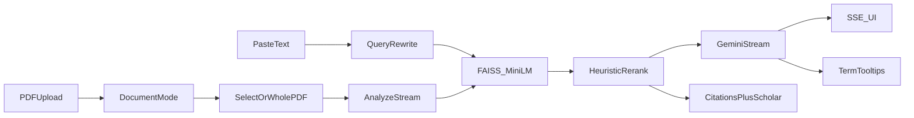

# DumbItDown

RAG-powered research simplification for students: paste a dense academic passage **or open a PDF in the interactive reader**, retrieve context from a **1,250-paper PubMed corpus**, and get a plain-English explanation with **citation contribution scores**, term tooltips, and follow-up Q&A.

Local MiniLM embeddings + FAISS (or Qdrant in cloud mode). Generation uses **Gemini 2.0 Flash**. No signup, no auth — a technical demo / research tool, not a multi-tenant SaaS.

[](https://youtu.be/bdRYcrhVcJg)  

## Architecture



1. Optional query rewrite (skipped for very short or long pastes)
2. FAISS similarity search (`all-MiniLM-L6-v2`)
3. Heuristic term-boost rerank
4. Gemini simplification with citation % and technical-term JSON trailer
5. SQLite conversation memory for follow-ups
6. **Document mode:** upload PDF → ephemeral session (TTL) → highlight text/tables/figures or simplify the whole paper → same citation + chat thread

## Quick start (local demo)

Requires **Python 3.10+**, **Node.js 18+**, and a free [Google Gemini API key](https://makersuite.google.com/app/apikey).

```bash
# 1) Env
cp .env.example backend/.env
# Edit backend/.env — set GOOGLE_API_KEY
# Keep EMBEDDING_MODEL=sentence-transformers/all-MiniLM-L6-v2
# Keep NORMALIZE_EMBEDDINGS=false (must match the FAISS index)

# 2) Frontend deps (first time)
cd frontend && npm install && cd ..

# 3) FAISS index (if missing — ~10–30 min first run, ~485MB on disk)
# Index files are gitignored: backend/vector_store/index.faiss + index.pkl
cd backend && python ingest_data.py && cd ..

# 4) Launch API :5000 + Vite :3000
python start.py
```

- App: http://localhost:3000  
- API docs: http://localhost:5000/docs  
- Health: http://localhost:5000/api/health  

Before filming a demo, warm the stack once:

```bash
python scripts/warm_demo.py
```

Curated paste texts: [demo/SAMPLES.md](demo/SAMPLES.md).

## Modes

| Mode | How | What you get |
|------|-----|----------------|
| **Compose** | Paste 10–10,000 chars (or use a sample chip) | Streamed simplify + sources % + term tooltips + follow-ups |
| **Document** | Drop a PDF on `/app` | Side-by-side reader + chat: highlight → *Dumb it down*, or *Simplify entire PDF* |

Uploaded PDFs are extracted, optionally enriched (tables/figures) in the background, and indexed into an ephemeral per-document store — they are **not** added to the PubMed corpus. Sessions expire per `DOCUMENT_TTL_HOURS` (default 24h).

## Tech stack

| Layer | Stack |
|-------|--------|
| Frontend | React 18, Vite, GSAP, Framer Motion, react-pdf / PDF.js |
| Backend | FastAPI, Uvicorn |
| Embeddings | HuggingFace `all-MiniLM-L6-v2` (local CPU) |
| Vector store | FAISS (local) or Qdrant (cloud) |
| LLM | Google Gemini 2.0 Flash (figure vision when provider is Google) |
| PDF | PyMuPDF (extract/enrich) + PDF.js (reader UI) |
| Sessions | SQLite (`conversations.db`, `documents.db`) |

## Demo video checklist

1. Run `python start.py`, then `python scripts/warm_demo.py`
2. Landing → **Try it** → `/app`
3. Paste Sample 1 from [demo/SAMPLES.md](demo/SAMPLES.md) (or use a sample chip in the UI)
4. **Simplify** → show Sources % + Scholar link → hover a term tooltip
5. Ask one follow-up
6. Optional: open a citation drawer / “How this answer was built” panel
7. Optional: upload a short PDF → highlight a dense paragraph → **Dumb it down** (or **Simplify entire PDF**)

## Tests

```bash
# Retrieval / health (needs FAISS index; LLM tests marked integration)
cd backend
pytest tests -q -m "not integration"
# Full path including Gemini:
pytest tests -q
```

## Deploy

Local Vite via `start.py` is the supported demo path. Docker / Railway / Fly are secondary — see [DEPLOY.md](DEPLOY.md).

## Non-goals

- No user accounts, OAuth, or billing
- Uploaded PDFs are extracted and simplified, **not** permanently indexed into the corpus
- PubMed/arXiv deep links only appear when IDs exist in metadata; otherwise use Google Scholar title search

## License

[MIT](LICENSE)
